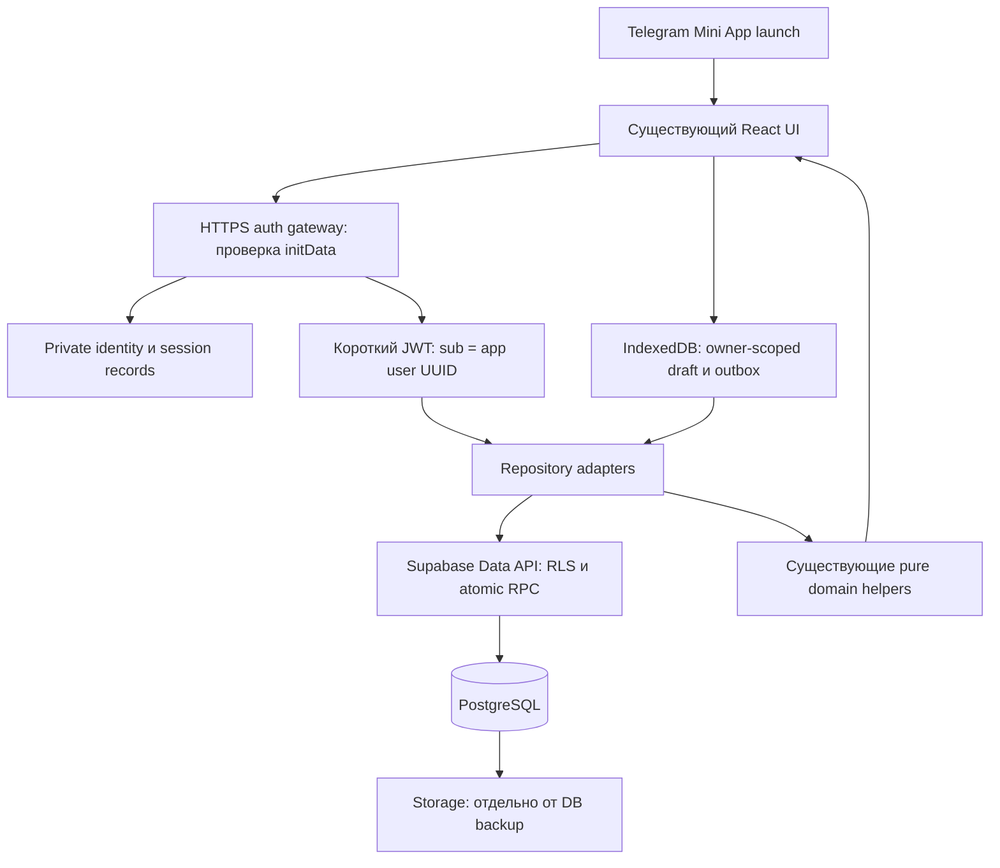

# Backend & Supabase Architecture Audit

Аудит: **30 октября 2026 года**. Проверенное состояние приложения:
`b5ceac5738eca5da904ee39b5e1f174739f52671`, ветка `main`.

Статус: **предложение для согласования, не реализованная интеграция**. В этом
этапе добавлен только этот документ. Облачные ресурсы, таблицы, buckets,
миграции, зависимости, секреты и production-конфигурация не создавались и не
менялись. Существующие Training / Nutrition / Coach / Progress / UI сохранены.

## 1. Current State

### Подтверждено кодом

- Единственное приложение — React 19 / TypeScript / Vite в `client/`.
  Recharts отображает данные текущей локальной истории. Backend, Supabase SDK,
  сетевых запросов приложения, серверной авторизации и облачной БД нет.
- В `src/storage/` три синхронных адаптера `localStorage`: профиль, история
  завершённых тренировок и счётчик завершений. Ключи не привязаны к Telegram
  identity. Это данные браузерного origin / WebView, а не аккаунта.
- [App.tsx](client/src/App.tsx) загружает их в React state. Ввод текущих подходов,
  difficulty, check-in, предложение/принятие адаптации и выбранный workout до
  завершения находятся только в памяти. Перезагрузка теряет черновик.
- Завершение сначала добавляет запись истории, затем отдельно сохраняет
  увеличенный счётчик. Это не транзакция. Сбой между записями, конкурирующие
  вкладки или повторное завершение могут рассогласовать данные.
- `load*` использует `JSON.parse(...) as Type`, без runtime-проверки формы,
  версии, ссылок и чисел. Непарсируемый JSON превращается в пустую историю /
  отсутствующий профиль / нулевой счётчик; это не доказывает отсутствие данных.
  Чтение `localStorage` находится вне `try`, ошибки записи тоже не обработаны.
- В истории нет `sessionId`, `userId`, `startedAt`, timezone, версии программы,
  назначения, slot instance или снимка prescription. Есть template ID, дата
  завершения, exercise ID, подходы, optional difficulty и session context.
- При старте подходы создаются заранее с номерами и иногда с весом прошлой
  тренировки. **Наличие строки или веса не доказывает выполнение подхода.**
  Кнопка завершения допускает неполные записи; их нельзя потерять при импорте.
- Результаты текущей тренировки индексируются по `exerciseId`, не по экземпляру
  упражнения. Повтор того же exercise в двух слотах будущей программы потребует
  отдельных instance ID; старые записи так восстановить нельзя.
- Единственный активный Base Program — `gym-fullbody-3`, version 1, три шаблона
  A/B/C, 15 слотов. Выбор следующего шаблона зависит от отдельного глобального
  `completedWorkoutsCount % 3`. Назначенная программа сейчас вычисляется заново,
  а не хранится. Home / Outdoor и программы 2/4 дня ещё не реализованы.
- Канонический каталог: 45 стабильных exercise ID, 26 equipment ID, 24 подробных
  movement ID; 43 упражнения с классифицированными метаданными и два
  `needs_review`. Есть OR/AND requirements и явная provisional Gym policy.
  Все `videos` пусты, все `technique` — пустые объекты. Девять legacy workouts
  и старый `workoutA` не являются источником активного Program Engine.
- Coach Memory вычисляется из последних восьми записей **с session context**
  в порядке массива, insights имеют дополнительные минимумы наблюдений.
  Отдельной сохранённой «памяти» нет. Progress строится из истории, использует
  локальный календарь браузера и текущую цель / daysPerWeek, не старое расписание.
- Nutrition — pure domain functions, типы и тесты: safety, activity, RMR,
  Starting Energy Estimate и DRI diagnostics. Nutrition onboarding, сохранение
  профиля, intake/weight tracking и Calibration Engine не реализованы.
  `WeightEntry`, `MenstrualCycleSettings`, `TrainingStrategy` — контракты,
  не существующие облачные или локальные пользовательские коллекции.
- Mock profile/progress лежат в коде, но не импортируются рабочим App. Их нельзя
  использовать как production seed пользовательских данных.

Основные источники: [storage](client/src/storage/),
[workoutSession types](client/src/types/workoutSession.ts),
[program resolver](client/src/domain/program/resolveCurrentWorkout.ts),
[catalog contract](client/src/data/EXERCISE_CATALOG.md),
[Coach Memory](client/src/domain/coach/buildCoachMemory.ts),
[Progress contract](client/src/domain/progress/README.md),
[Nutrition contract](client/src/domain/nutrition/startingEnergy.md).

### Telegram и размещение: граница подтверждённых сведений

По сообщению владельца приложение открывается в Telegram. В текущем checkout
нет обращения к `Telegram.WebApp`, SDK script, чтения `initData`, проверки
подписи или Telegram user ID. Открытие сайта через кнопку Mini App само по себе
не является авторизацией пользователя.

В репозитории есть только команды Vite `dev`, `build`, `preview`; production
артефакт — `client/dist`. Нет deploy workflow, Dockerfile, CNAME,
Vercel/Netlify-конфигурации, URL production или конфигурации BotFather. GitHub
хранит исходный код; из этого не следует использование GitHub Pages.
Действующие host, домен, build pipeline, bot ID, launch mode и настройки
BotFather **не установлены по репозиторию**. Их нужно подтвердить до выбора
same-origin proxy / cookies / CORS. Настройки бота в этом аудите не менялись.

В отслеживаемых файлах нет `.env` и известных секретов. Общего правила `.env*`
в `.gitignore` нет; перед первым введением credentials отдельный setup-этап
должен добавить ignore и secret scanning, оставив только пустой `.env.example`.
Любая переменная `VITE_*` попадает в публичную сборку; префикс не защищает секрет.

## 2. Data Inventory

| Данные | Текущее хранение | Будущее хранение | Стратегия переноса |
| --- | --- | --- | --- |
| Telegram identity | Отсутствует | `private.telegram_identities` → `app.users` | Создавать только после серверной проверки; не выводить владельца из локальных записей |
| Environment, daysPerWeek, level | `fitness-onboarding-profile` | `app.training_profiles` | Runtime validation, preview, явное подтверждение владельца локальных данных |
| Goal type, target, priority | В том же профиле | `app.training_goals` | Сохранить структуру цели, не заменять её одним emphasis ID |
| Оборудование пользователя | Optional поле профиля; onboarding его не собирает | `inventory_status` + `app.user_equipment` | Отсутствие → `not_collected`; `[]` → `known` без строк; invalid → карантин, без угадывания |
| Счётчик завершений | `fitness-user-progress` | `app.user_progress_state` | Сохранить baseline независимо от history length; согласовать расхождения до cutover |
| Завершённые тренировки | `fitness-workout-history` | Sessions → exercise instances → set results | Стабильные import/session ID, preview дублей, транзакция, сверка подтверждённых записей |
| Рабочие веса и repetitions | В подходах истории; prefills в памяти | `app.session_sets`, nullable значения | Не превращать пропуск в 0; не считать prefill выполнением; не менять kg convention |
| Subjective exercise difficulty | Optional поле результата упражнения | `app.session_exercises.difficulty` | Сохранить enum и отсутствие значения |
| Check-in, симптомы, сон | Context завершённой сессии; до неё — RAM | Отдельные защищённые check-in таблицы | Только после согласованного основания/согласия для чувствительных данных |
| Offered/accepted adaptation, actions/reason | Context завершённой сессии | Adaptation + ordered action rows | Сохранить offered и accepted отдельно; предложение ≠ фактически применённый план |
| Незавершённая тренировка | React state | IndexedDB draft + optional cloud draft | Старый RAM после закрытия невосстановим; новая запись с UUID и local commit до сетевого запроса |
| Назначенная программа / frozen plan | Вычисляется из профиля и счётчика | Versioned program assignment + session prescription | Для новых сессий зафиксировать при старте; для старых не подставлять сегодняшнюю версию |
| Exercises, equipment, movements | TypeScript-каталог | Нормализованный versioned catalog | Детерминированный seed из проверенного commit; сохранить все 45 ID и pending statuses |
| Programs, templates, candidates, emphasis | TypeScript, один активный program | Versioned relational catalog | Сначала bundled source; затем сравнение полного resolver output перед переключением |
| Общие видео / инструкции | Поля есть, контент пуст | Storage + catalog media/instructions | Сейчас переносить нечего; отдельная публикация проверенного контента |
| Coach Memory / insights | Derived из истории, не сохранены | Derived из загруженной истории | Не создавать отдельную authoritative memory table; сохранить порядок наблюдений |
| Графики Progress | Derived, period/exercise только RAM | Derived, необязательные локальные UI preferences | Не переносить chart points в БД; сохранить timezone semantics и честные empty states |
| Nutrition profile / estimates / DRI | Типы, функции, fixtures, не пользовательское хранилище | Отдельное будущее Nutrition-хранилище | Сейчас не создавать и не заполнять таблицы; synthetic personas не импортировать |
| WeightEntry / food entries / cycle / private review video | Не реализованы | Отдельные будущие модели | Нет исходных пользовательских данных для миграции; не создавать фиктивные записи |

Три legacy ключа origin-wide и не доказывают Telegram-владение. На общем устройстве
их нельзя автоматически приписывать первому вошедшему аккаунту. Изменение домена
или WebView storage partition также не переносит их автоматически.

## 3. Proposed Architecture

### Минимальная beta: React + auth gateway + Supabase



Рекомендация: небольшой auth gateway на Supabase Edge Functions, предпочтительно
через HTTPS proxy под доменом приложения, если hosting это поддерживает. Он
проверяет Telegram и обслуживает refresh/logout. Обычные чтения выполняются
с user JWT под RLS; завершение, импорт и conflict-aware draft updates — atomic
RPC. Routine workout operations не используют `service_role` / secret API key.
Server secrets нужны только gateway и строго ограниченным административным jobs.

Gateway работает с `private` identity/session tables по серверному TLS PostgreSQL
connection через pooler и отдельную минимальную роль `auth_gateway`, а не
выставляет private schema в Data API ради admin client. Роль не владеет таблицами,
не имеет BYPASSRLS и не читает workouts/check-ins; ей нужны только identity/session
операции и контролируемый bootstrap `app.users`. Проверить Edge runtime/pooler
совместимость и connection limits в auth PoC. Signing private key остаётся в
secret manager, а не в этой БД. Для regular user запросов используются user JWT.

Не переносить Training Engine в SQL или Edge Function в этом этапе. В будущем
repository adapter возвращает существующие domain DTO; дополнительный cloud
envelope несёт IDs, revisions, provenance и sync status. Например, планируемые
границы — `ProfileRepository`, `WorkoutHistoryRepository`, `DraftRepository`,
`CatalogRepository`. JSX не должен знать о SQL rows, ключах Storage или retry.

Сначала локальное надёжное сохранение → outbox → подтверждение облака.
Сохранение на сервере и отображение локальной pending записи — разные статусы;
«синхронизировано» показывается только после подтверждения. Online/offline не
меняет правила подбора, progression, Coach или Nutrition. Сервер валидирует
структуру и права, но не объявляет reported вес объективно измеренным.

После cutover облако — источник подтверждённых account-owned записей;
IndexedDB — черновик, cache и очередь конкретного пользователя. До завершения
миграции legacy localStorage остаётся сохранённым исходником. Не включать
бесконтрольный dual write в старый append и облако: он создаёт дубли.

Supabase Auth не имеет автоматически появляющегося Telegram `initData` login.
Для beta предлагается собственный Telegram → app UUID bridge и короткие JWT
через **импортированный асимметричный signing key**, поддержанный Supabase [S2].
`app.users` — наш реестр; это не обещание native Supabase Auth sessions или
записей в `auth.users`. FK на `auth.users` не использовать в этом варианте.
Не создавать фиктивные email/password аккаунты. Первая staging-проверка должна
подтвердить custom UUID `sub` → `auth.uid()` → Data API / RPC / Storage RLS.
Если этот путь не подтверждается в выбранном project/runtime, остановиться до
реализации, а не подменять его admin-доступом. Внешний OIDC provider [S3] —
альтернатива для отдельного согласования, не дополнительная зависимость beta.

## 4. PostgreSQL Schema

Это логическая схема, **не executable migration**. Таблицы ниже создаются по
этапам: пользовательское хранение сначала, полный catalog в этапе 8, media в
этапе 9. Schema names `app`, `catalog`, `private` — предложение. Exposed schemas
настраиваются явно; `private` никогда не выставляется через Data API.

### Ключи, версии и общие правила

- Пользователь и session/exercise instance — UUID. Telegram ID — PostgreSQL
  `bigint CHECK (> 0)`, в API decimal string; username не является ключом.
  Уникальность identity: `(bot_id, telegram_user_id)`, user FK. Разные bots не
  объединяют аккаунты автоматически.
- Существующие exercise/program/template slug ID остаются стабильными text keys.
  Revision rows имеют UUID и `UNIQUE(entity_id, version)`, version > 0.
  Опубликованные revisions неизменяемы; новый контент — новая revision.
- Время — `timestamptz`; `completed_at` означает reported client time,
  `received_at` — независимое серверное время. Не заменять одно другим.
  Для новых сессий фиксировать IANA timezone; legacy timezone остаётся unknown.
- Каждая пользовательская child row содержит `user_id` и составной FK к
  owner-scoped parent. Это намеренная небольшая денормализация для RLS и защиты
  от присоединения чужого parent ID, а не повторение всей структуры TypeScript.
- Справочники / CHECK ограничивают существующие enum значения. Все nullable
  поля означают неизвестность, а не автоматически вычисленный default.
  Published content редактирует только curator/admin; consumer read-only.

### Identity, профиль и назначение

| Таблица | Основные поля и ограничения |
| --- | --- |
| `app.users` | `id PK`, `status(active/deleting)`, `created_at`; self-read, создание/удаление только server workflow |
| `private.telegram_identities` | `user_id FK users`, `bot_id bigint`, `telegram_user_id bigint`, `created_at`; unique пары identity, без username/имени/фото/raw initData |
| `private.auth_sessions` | `id PK`, `user_id FK`, hash refresh token, issued/absolute expiry, revoked_at, rotation version; серверная проверка refresh/revocation, plaintext refresh не хранить |
| `private.init_data_redemptions` | Unique digest проверенного launch payload, auth_date, expires_at; короткоживущая защита повторного обмена, без raw payload |
| `private.user_consents` | user_id, purpose, notice/policy version, granted_at/withdrawn_at, source; история подтверждённого optional wellbeing consent, не client boolean «всё разрешено» |
| `app.training_profiles` | `user_id PK/FK`, environment, days_per_week ∈ {2,3,4}, level, `inventory_status(known/not_collected)`, timezone, revision, updated_at |
| `app.user_equipment` | `PK(user_id,equipment_id)`, FK equipment; отсутствие строк при known означает известный пустой inventory, не unlimited Gym |
| `app.training_goals` | `user_id PK/FK`, goal_type, target_kind/key, priority, revision; FK controlled goal targets; whole_body — явная цель |
| `app.program_assignments` | `id PK`, user_id, exact program_revision_id, emphasis revision, assigned_at/ended_at, goal snapshot, resolver version, catalog release; максимум одно действующее назначение |
| `app.user_progress_state` | `user_id PK`, completed_workouts_count ≥ 0, revision, import baseline metadata; writable только через проверенную completion/import transaction |

`program_assignments` меняются новым назначением, не переписыванием старого.
Legacy workouts не получают нынешнее назначение задним числом. Счётчик остаётся
совместимым с текущим глобальным счётчиком resolver; считать его автоматически
по количеству импортированных строк запрещено. Timezone — новая preference,
при первой синхронизации подтверждается, а не объявляется исторически известной.

`catalog.goal_targets(kind,key)` отделяет цели от exercises/muscles. Например,
текущий goal target `pull_up` и exercise ID `pull-up` — разные пространства
имён; нельзя механически сделать между ними FK или переименовать историю.

### Контент для 200+ exercises / 70+ programs

| Таблица / связь | Назначение |
| --- | --- |
| `catalog.releases` | Published manifest с source commit, schema version и checksum; атомарный набор совместимого контента |
| `catalog.equipment`, `catalog.movement_patterns`, `catalog.goal_targets` | Controlled ID и display labels; 26/24 существующих IDs, не Russian-string matching |
| `catalog.exercises` → `exercise_revisions` | Identity → name, level, review statuses, equipment requirement kind, revision/release; retirement без удаления истории |
| `exercise_environments` | `PK(exercise_revision_id,environment)`, Gym/Home/Outdoor membership; не означает наличие программы |
| `exercise_movements`, `exercise_target_types` | Join к controlled patterns / reps,time,distance; supported target не реализует таймер или новый logging |
| `exercise_equipment_options` → `exercise_equipment_items` | `UNIQUE(exercise_revision_id,option_number)`; option items уникальны. OR между options, AND внутри option |
| `exercise_legacy_muscle_labels` | Текущие плоские labels как legacy labels; не выдавать их за reviewed primary/secondary muscles |
| `exercise_instruction_items` | Revision FK, section(setup/start/movement/breathing/mistake/warning), ordinal, text; отсутствие контента = отсутствие строк |
| `catalog.programs` → `program_revisions` | Stable ID → title, version, days_per_week, split, publication state |
| `program_environments`, `program_levels` | Явные memberships конкретной program revision |
| `catalog.workout_templates` → `workout_template_revisions` | Stable template ID → immutable title, estimated minutes, revision |
| `program_workouts` | `(program_revision_id,position) PK`, точный template revision FK; сохраняет A/B/C, допускает повтор template в разных позициях |
| `template_slots` | UUID, template revision FK, stable legacy slot key, position, role, legacy slot pattern, optional, prescription fields |
| `slot_tags` | Ordered/unique tags текущих правил; не смешивать legacy muscle-like tags с detailed movement taxonomy |
| `slot_candidates` | `(slot_id,position) PK`, exact exercise revision FK; unique exercise в слоте; порядок имеет значение |
| `emphasis_revisions`, `emphasis_rules`, `emphasis_rule_exercises` | Existing preference rules по slot tag и ordered exercise IDs; balanced = отсутствие preferences |

Prescription — структурированные столбцы `sets`, `target_type`, `target_mode`,
`target_min`, `target_max`, `target_value`, `rest_min_seconds`,
`rest_max_seconds`. CHECK: sets > 0; rest ≥ 0 и min ≤ max; range требует min/max,
fixed — value, max не несёт выдуманного value. Несовместимые поля NULL.
`target_type` поддерживается выбранным exercise revision. Published program
должен иметь workouts/slots/candidates, reviewed content и корректные ссылки.

Непустоту options/items, соответствие target и parent inventory status проверяет
publish transaction / deferred constraint trigger: обычный CHECK не проверяет
строки других таблиц. Для `external` нет пустых alternatives; для
`no_external_equipment` нет options; `needs_review` не может попасть в
автоподбор. Известный inventory не получает provisional fallback. Эти правила
эквивалентны текущим helpers, не новые алгоритмы.

Catalog хранит candidates и preference data, не исполняемый произвольный JSON/SQL
«движок правил». Typed `add_sets` сейчас selector не применяет — хранение в
облаке не должно внезапно активировать его. Новые substitution/progression rules
нуждаются в отдельном domain этапе. Не создавать 70 копий программ ради count.

На этапе 2 достаточно bootstrap identity/revision keys **реального bundled
контента** для FK новых сессий; его metadata пока остаётся в коде. На этапе 8
добавляются перечисленные content relations и seed ровно проверенных данных.
Сравниваются все 27 Gym combinations и оба inventory режима существующих
regression fixtures. Один pinned release читается целиком и кэшируется для
offline; нельзя смешивать новые candidates со старой template revision.

### Завершённые тренировки и историческая корректность

| Таблица | Поля / ограничения |
| --- | --- |
| `app.workout_sessions` | `id PK`, `user_id FK`, `client_session_id UUID`, status(draft/completed/abandoned), started_at nullable, completed_at, received_at, timezone nullable, assignment/revision FKs nullable для legacy, legacy_template_id, origin, client/server revision, recorded_sequence, provenance; `UNIQUE(user_id,client_session_id)`, `UNIQUE(user_id,id)`, unique owner/recorded_sequence |
| `app.session_exercises` | `id PK`, user_id/session_id composite FK, ordinal, stable exercise_id FK, exercise_revision_id nullable для legacy, source_slot_key nullable, name snapshot nullable, effective prescription columns nullable, difficulty enum nullable; unique `(session_id,ordinal)`, **не** unique exercise_id |
| `app.session_sets` | `id PK`, user_id/exercise_instance_id composite FK, set_number > 0, reps integer nullable ≥ 0, weight_kg numeric nullable ≥ 0, observation_state(draft_prefill/reported/unknown_legacy/skipped); unique `(exercise_instance_id,set_number)` |
| `app.session_checkins` | One row/session, owner FK; feeling, optional sleep_quality, has_training_issue, available_minutes nullable; legacy_notes nullable только если реально были в источнике и согласованы к переносу; отдельный sensitive read/export grant |
| `app.session_checkin_symptoms` | Check-in owner FK + controlled symptom code, unique пары; не free-form диагноз |
| `app.session_adaptations` | One row/session; offered, accepted, optional reason/target_minutes, adaptation model version; accepted требует offered |
| `app.session_adaptation_actions` | Owner/parent FK, ordinal + controlled action, unique action; сохраняет предложение независимо от принятия |

Точность веса сохраняется без неявного округления к 0.5 kg; kg convention и
equipment variant у старого `romanian-deadlift` / `incline-bench-press` неизвестны.
Не вычислять из них total dumbbell load, 1RM или новый strength score.
Numeric не должен допускать NaN/Infinity; API также отвергает не-finite numbers,
некорректные даты, неподдерживаемые enum, oversized payloads и повторы set_number.
Конкретные engineering upper bounds согласуются отдельно; legacy anomalous
values изолируются с причиной, не обрезаются и не теряются.

У новых сессий при старте фиксируются assignment, source commit/release,
program/template/exercise revisions, engine version и исходное назначение.
Effective prescription копируется в session exercise rows **после** принятой
адаптации. Оригинальный план, включая удалённые при сокращении упражнения,
хранится отдельным bounded, schema-versioned `original_plan_snapshot` у session.
Это осознанный immutable audit snapshot выбранных полей, а не JSON-копия всего
каталога вместо relational schema. Наличие actions не доказывает применение
каждого action; источником фактического плана остаётся effective prescription.

Legacy records сохраняют известные template/exercise IDs и результат как есть.
Неизвестные program version, slot, original/effective plan, start time и timezone
остаются NULL с `provenance=legacy_unversioned`. Даже знакомый template ID не
доказывает старую prescription. Неизвестные exercise IDs сохраняются в import
quarantine / legacy reference до review; не заменяются похожим упражнением.

Завершённый snapshot неизменяем. Исправление результата в будущем — отдельный
revision/correction workflow; не upsert поверх истории новым каталогом.
Удаление аккаунта/сессии остаётся допустимой отдельной owner-authorized операцией.
Нельзя каскадно удалить пользовательские результаты при удалении catalog row:
FK `RESTRICT`, retirement вместо удаления. `ON DELETE CASCADE` допустим для
собственных child rows при согласованном удалении session/account.

Composite FK, например `(user_id,session_id) → workout_sessions(user_id,id)`,
обязателен и для nested rows; FK только по session UUID недостаточен.
Поисковые индексы: `(user_id,completed_at,id)` completed sessions,
`(user_id,exercise_id,session_id)`, parent FKs, unique client session key,
active assignment partial unique, expiry/revocation indexes. Историю читать
keyset pagination. Для существующего App / progression / Coach adapter сохраняет
append-порядок через `(user_id,recorded_sequence)`: первый import резервирует
sequence по original ordinal manifest, не по порядку прибытия сетевых batches;
новые завершения получают следующий sequence атомарно. Backdated client time
не переставляет старые записи. Progress helpers уже сами сортируют по датам;
для date-range запросов есть отдельный порядок `completed_at,id`. Coach получает
нужные последние context-bearing sessions, а не случайную страницу. Импорт со
второго устройства требует reconciliation также порядка, не только counts.

### Миграционные и отложенные модели

`app.import_batches` хранит owner, source installation ID, schema/source versions,
manifest checksum, baseline counter, counts и статус сверки.
`app.import_items` — stable source item ID/occurrence, fingerprint, cloud session
ID или quarantine reason, acknowledged status; unique owner/source/item key.
`app.request_receipts` — user-scoped idempotency key, payload hash, operation,
resource ID/result status. Не хранить raw health payload в receipts/logs.

Не создавать сейчас weight/food/macro/calibration/cycle/Technique Review/
subscription/AI coach tables. При реальном Weight Tracking понадобятся
owner-scoped `weight_entries(id,user_id,recorded_at,weight_kg,source,revision)`
с наблюдением вместо стартовой гипотезы; Nutrition — отдельные inputs и
model-versioned estimates, не overwrite наблюдений. Primary/secondary muscles
добавятся как reviewed `muscles` + `exercise_muscles(exercise_revision_id,
muscle_id,role)`, когда будет утверждена taxonomy. Current flat labels нельзя
автоматически объявить primary. Это запланированные расширения, не DDL этапа 2.

## 5. Telegram Authentication

### Обмен launch data на сессию

1. Клиент берёт **raw** `Telegram.WebApp.initData` и передаёт только HTTPS POST
   auth gateway, не URL query/logging. `initDataUnsafe`, отдельно присланные
   user.id, username, query_id или profile не являются доказательством identity.
   Пустой initData в обычном браузере не даёт доступ к чужому cloud account;
   сохраняется guest/local режим без автоматического импорта.
2. Gateway ограничивает payload size, rate-limits, разбирает query string один
   раз, отвергает duplicate keys и malformed hash/auth_date/user. HMAC data-check
   string: отсортированные `key=value` через LF, исключая `hash`; values берутся
   из decoded query без повторной сериализации JSON. Secret key —
   `HMAC-SHA256(key="WebAppData", message=BOT_TOKEN)`, затем
   `HMAC-SHA256(key=secret_key, message=data_check_string)`. Сравнение hex hash
   constant-time после проверки длины/формата. В HMAC-путь нельзя механически
   переносить исключение `signature` из отдельного Ed25519 validation flow.
3. Проверяет `auth_date`: предлагаемый launch TTL 5 минут, future clock skew
   максимум 30 секунд. Это выбранные engineering defaults, не обещание Telegram
   о безопасной длительности. Валидная подпись старого payload недостаточна.
   Использовать проверенную библиотеку и fixtures официального протокола [S1]
   до реализации; ID token другого Telegram login flow не равен Mini App initData.
4. Только после проверки подписи извлекает verified user.id и привязывает его к
   UUID через unique identity внутри транзакции. Клиент не выбирает bot_id,
   user_id, role или admin metadata. Test/prod bots и проекты разделены.
5. Создаёт server session и одноразовый redemption digest с коротким retention.
   Повторный payload не должен создавать новую сессию без контроля replay.
   Легитимные повтор/reload/потеря login response покрываются PoC: existing
   refresh session либо новый Telegram launch; нельзя отдавать старые токены
   любому предъявившему digest. Украденный **до первого обмена** свежий initData
   остаётся bearer credential — TTL не заменяет TLS и исключение его из логов.
6. Выдаёт JWT на 10 минут: `sub=app.users.id` (UUID), `role=authenticated`,
   `iss` ровно gateway issuer, `aud=authenticated`, `iat`, `nbf`, `exp`, `sid`.
   ES256 + `kid` импортированного активного ключа; private key только server-side.
   Supabase publishable key + этот JWT применяются в Data API / RPC / Storage.
   Собственные JWT передавать через `accessToken` adapter, не через фиктивный
   `signInWithIdToken` provider или `setSession` с выдуманным Supabase refresh.
7. Gateway проверяет custom JWT библиотекой с allowlist alg/issuer/audience/kid,
   сроками и session status; `getUser()` / `getClaims()` native Auth не считаются
   валидатором собственной auth session [S2]. RLS дополнительно проверяет `sid`,
   active account и issuer, поэтому logout/deletion отзывает доступ до истечения
   JWT. Нельзя полагаться только на React state «пользователь вошёл».

### Session transport и refresh

Рекомендация: access JWT только в памяти, opaque refresh token в HttpOnly Secure
cookie auth gateway, хранение только его hash на сервере. Предлагаемые limits:
absolute session lifetime 7 суток, idle timeout 24 часа; rotation при refresh,
обнаружение повторного использования и отзыв family. Race двух refresh-запросов
должен иметь определённую bounded/idempotent обработку, не случайно разлогинивать
обе вкладки. Refresh не требует просроченного initData заново.

Same-origin proxy уменьшает CORS сложность, но **не гарантирует** cookie в
Telegram Web iframe: third-party cookie rules зависят от клиента. До фиксации
транспорта проверить Telegram iOS/Android/Desktop/Web. SameSite=None требует
Secure и CSRF защиты; где работает first-party режим, предпочесть более строгий
SameSite. Exact allowed origins, Origin/CSRF validation для cookie endpoints,
отсутствие wildcard credentialed CORS, `Cache-Control: no-store` обязательны.
Auth не строится на Referer/Origin вместо подписи.

Если cookies в целевых клиентах недоступны, согласовать memory-only opaque
refresh с безопасным повторным Telegram launch после reload; не переносить
долгоживущий секрет в localStorage как скрытый fallback. Этот UX/hosting выбор
нужно подтвердить до rollout. При logout очищаются owner-scoped cache и память,
останавливается его outbox; другой аккаунт не получает старый draft.

## 6. Storage and Video

| Тип | Предлагаемый bucket/path | Metadata и доступ |
| --- | --- | --- |
| Общие exercise videos | `exercise-videos/exercises/{exerciseId}/{revision}/{assetUuid}.mp4` | `catalog.media_assets` + `exercise_videos(exercise_revision_id,asset_id,type,position,title)`; immutable object key, content hash, byte size, MIME/duration/status |
| Будущие приватные видео | Отдельный **private** `technique-review/{userUuid}/{submissionUuid}/original.mp4` | Будущая review/submission model с owner; сейчас не создавать, не принимать uploads |

Для общих видео рекомендуются private bucket и authenticated read / короткий
signed URL. Пользователи не имеют upload/update/delete grant; публикует curator.
Если владелец сознательно выбирает public distribution, URL доступен всем
обладателям и RLS **не ограничивает скачивание** [S5]. Public не выбирать только
ради простоты. В БД хранятся object key и связь с exercise revision, не истекающий
signed URL. Типы technique/setup/detailed соответствуют существующему контракту.

Предлагаемые beta-ограничения общего ролика: MP4 H.264/AAC, 720p, до 90 секунд,
до 25 MiB, poster JPEG/WebP. Проверять реальный контейнер/кодеки/длительность,
а не только extension или client Content-Type. Административная подготовка и
сжатие перед публикацией; Storage не считать автоматическим transcoding/HLS
сервисом. Мобильная проверка включает Range/seek, playback в Telegram, слабую
сеть, `preload=metadata`, загрузку по требованию без autoplay всех роликов.

Private user uploads — отдельный будущий этап с opt-in, short-lived upload
capability к **server-chosen owner path**, quotas, MIME/size validation,
quarantine/processing, consent на просмотр и коротким retention. Ни public URL,
ни list всего bucket. Владелец видит только свои objects; reviewer — только
после отдельного назначения и аудита, не все тестировщики/администраторы подряд.
Предварительный cap 90 секунд / 50 MiB требует проверки global/bucket limits;
по проверенной документации Free допускает global limit не выше 50 MB [S5].
MiB и тарифные MB не считать одинаковым пределом: итоговый cap задавать в bytes.

Подписанный download URL — временный bearer access, например 5 минут; его нельзя
логировать или сохранять как permanent permission. Отзыв аккаунта не отзывает
уже выданный URL мгновенно; учитывать TTL. Скачанную копию технически не отозвать.
Удалять через **Storage API**, не SQL `DELETE storage.objects` [S6]. Job удаления
идемпотентен, с tombstone/retry; сначала закрыть доступ, затем удалить object и
согласованно пометить metadata. Не удалять video revision из истории упражнений
каскадом. DB backups не включают сами blobs [S7]; нужен отдельный object backup
или восстанавливаемые лицензированные master-файлы для общего контента.

Supabase Storage достаточно для первой beta коротких учебных роликов при
проверенных quotas/бюджете. Масштаб: 200 × 15 MiB ≈ 2.93 GiB контента;
100 пользователей × 3 тренировки/неделю × 4 недели × 5 просмотров × 10 MiB
≈ 58.6 GiB выдачи/месяц до учёта повторов/кэша. Это **сценарий нагрузки**, не
наблюдаемые данные или обещание бесплатного тарифа. Цены/egress/Storage quotas
проверяются при выборе плана. Private Technique Review и длинное streaming video
позже могут потребовать processing/CDN/video service; сейчас его не проектировать
как уже работающую функцию.

## 7. Security / RLS

### Матрица доступа

| Субъект | Доступ |
| --- | --- |
| Guest / publishable key без user JWT | Нет профилей, истории, check-ins, private Storage; public content только если отдельно опубликован |
| Пользователь с valid app session | Только свои profile/assignment/history/drafts; write через проверенные операции; approved content read |
| Другой пользователь | Ни rows, ни nested joins, ни exports, ни objects/signed URLs владельца |
| Auth gateway | Private identity/session операции; административный секрет не используется routine history API |
| Catalog curator | Content/media publication без права читать самочувствие пользователей |
| Support / operator | Минимальная operational metadata; исключительный доступ к personal data только с основанием, сроком и audit |

На всех app tables включить RLS, отозвать лишние default grants у PUBLIC/anon.
Для user-facing reads минимальный паттерн (иллюстрация, не применённый SQL):

```sql
create policy own_sessions_select on app.workout_sessions
for select to authenticated
using (
  user_id = (select auth.uid())
  and (select private.is_active_app_session())
);
```

Helper проверяет строго ожидаемые issuer/audience, `sid`, user ID, expiry и
revocation server session / account. Он использует JWT claims, выставленные
**проверенным** Data API, не JSON из тела запроса. Если нужен SECURITY DEFINER
для чтения private sessions: отдельный минимальный owner, pinned `search_path`,
schema-qualified references, boolean result без утечки чужих записей. Helper
не принимает произвольный user ID. Проверка account status не должна рекурсивно
вызывать ту же policy через `app.users`. Private schema не exposed. Общую
session/issuer проверку закрепить restrictive policy для соответствующих ролей,
чтобы добавленная позже permissive policy не открыла обход active-session gate.

Каждая политика записи должна проверять владельца существующей строки
(`USING`) и результата (`WITH CHECK`), включая перенос parent/FK. Одних
client `.eq('user_id', ...)` и opaque UUID недостаточно. Для children RLS и
composite FK обязательны; для Storage — bucket + owner prefix + active session,
путь сам по себе не является доказательством владения.

Прямые DML grants для finished sessions/results/counters не выдавать
`authenticated`. Atomic write RPC ограничены операцией и используют проверенный
`auth.uid()`; supplied user_id отвергается/игнорируется. Security-definer writer,
если нужен для закрытых DML, — non-login, non-table-owner, NOBYPASSRLS,
минимальные table grants и собственные RLS policies с USING/WITH CHECK.
Не создавать universal SQL RPC или функцию с правами postgres, вызываемую
всеми. Owner identity и active session проверяются внутри каждой privileged
операции. Выполнение отзывов/удаления — отдельная узкая server authority.

Views должны быть security-invoker либо закрыты: обычная owner view может
обойти RLS. Не включать Realtime для personal tables, пока в нём нет нужды.
Тестировать настоящими user JWT / anon, не admin client: admin bypass доказывает
лишь наличие строк, не корректность изоляции [S4].

### Secrets и operational controls

- BOT_TOKEN, signing private key, database credentials, Supabase secret/service-role
  keys — secret manager server runtime. Не React, не `VITE_*`, не GitHub
  issues/fixtures, не URL. Refresh token hash — в private session table,
  plaintext — только установленный memory/HttpOnly transport. Publishable key
  и project URL допустимы в клиенте, но не заменяют RLS.
- Separate staging/prod, отдельные test bot/users и secret scopes. SQL migrations
  / synthetic fixtures коммитятся; реальные tester profiles, exports, videos,
  DB dumps и `.env` не коммитятся. Перед появлением credentials — ignore rules,
  CI secret scan и проверка production bundle на privileged material.
- HTTPS, exact CORS, CSP с разрешёнными Telegram SDK/asset/connect origins,
  dependency updates, MFA владельцам проекта, rate limits на auth/import/media,
  payload limits. Auth headers, raw initData, body check-in и signed URLs не
  попадают в access/error/analytics logs. Error telemetry — operation ID/status.
- Versioned migrations через staging и review. Перед destructive migration —
  restore-tested backup, rollout flag и rollback plan; отключение cloud write
  не должно удалять локальный acknowledged/pending источник.

### Приватность первой beta, включая ЕС

Минимальные identity данные — Telegram numeric ID + internal UUID. Не собирать
phone, real name, username, contacts, location или фото без отдельной функции.
Самочувствие, симптомы, сон и некоторые inferred insights могут быть health
data по Art. 9 GDPR; фитнес-контекст не делает их автоматически обычными данными.
Не импортировать их в облако молча вместе с основной тренировкой.

До набора тестировщиков: определить controller/contact, Art. 6 basis для аккаунта
и истории, Art. 9 condition (для предлагаемой beta — отдельное явное согласие
на optional wellbeing), понятную privacy notice, withdrawal/export/deletion,
retention, EU project region, DPAs с Supabase и hosting provider, subprocessors
и оценку международных передач, включая Telegram. EU region сама по себе не
равна GDPR compliance. Оценить необходимость DPIA до обработки чувствительных
данных; не объявлять её автоматически обязательной только из-за числа 100.
Предложение по audience — beta 18+, без импорта ещё не реализованных cycle /
medical/Nutrition safety fields. Это требует решения владельца, не новая
проверка возраста в текущем UI.

Если wellbeing consent отсутствует, импорт core workout отделяется от sensitive
context; последний остаётся локально, с явным статусом неперенесённых данных.
Нельзя отметить такой импорт как полный или придумывать Coach insights. Его
включение/withdrawal и поведение Coach при удалении context согласовать до
реализации, не менять domain молча. Free-text notes сейчас UI не собирает:
не открывать новое поле «диагноз» только потому, что тип содержит `notes?`.

Предлагаемая retention для согласования: workouts до account deletion / окончания
beta + 30 дней, check-in 90 дней, abandoned drafts 30 дней, redacted operational
logs 14 дней. Refresh/redemption records — только срок жизни + короткое окно
разбора incident. Не включать общедоступную аналитику/рекламу на health payload.

Deletion workflow: подтвердить активную owner session → revoke sessions/закрыть
доступ немедленно → создать resumable deletion job → удалить private blobs через
Storage API → удалить child rows, account/identity и local cache на подключённом
клиенте → выдать итоговый статус. Плановый срок live purge — до 7 дней после
запроса; точный policy утверждается владельцем. Офлайн-устройство не стирается
удалённо мгновенно: при следующем подключении не принимать его старую outbox.
Повторный вход после удаления не должен автоматически восстановить legacy cache.

Backups: выбранный paid plan с daily DB backups либо собственный encrypted
off-site dump workflow; не считать Free автоматически резервируемым [S7].
Предложение beta RPO ≤ 24 ч, RTO ≤ 1 рабочий день, обязательный staging restore
drill. Для Storage — отдельная стратегия. Удалённые personal data могут оставаться
в изолированных backup до утверждённого expiry; не доступны приложению. При
restore повторно применить deletion ledger до открытия доступа и не воскресить
аккаунты/согласия. Ledger хранить отдельно от восстанавливаемой БД, с минимумом
псевдонимных данных и ограниченным retention; не в публичном GitHub.

## 8. Local Data Migration

### Без потери исходника

1. Перед cutover выпустить отдельно local persistence/outbox поддержку. Пока
   мигрируется старый snapshot, новые завершения должны либо ждать короткого
   freeze, либо получать новые UUID и отдельную очередь; snapshot не «плывёт».
2. На **том же origin/WebView** прочитать raw значения трёх ключей. Создать
   локальную immutable backup-копию и опциональный пользовательский export;
   сначала сохранить её, затем парсить/валидировать. Не вызывать старые load*
   как единственный extractor: они скрывают invalid JSON за пустым значением.
   При смене домена — export/import из старого origin до отключения старого host;
   новое приложение не может прочитать чужой origin через браузер.
3. Сверить schema, enums, dates/timezone uncertainty, числовые поля, repeated
   exercise IDs/set numbers, references и размер. Неполные валидные записи
   сохранить; invalid records — локальный quarantine с причиной и export,
   не молча удалить. Список известных ID брать из pinned каталога, не fuzzy name.
4. После verified Telegram login показать profile/history preview, owner claim
   «это мои локальные записи», counts и отдельный выбор sensitive import.
   Не назначать данные автоматически по новому Telegram user.id на устройстве.
5. Создать owner-scoped persistent import manifest: installation UUID, batch UUID,
   stable source item UUID, original ordinal, canonical fingerprint, occurrence
   index. UUID каждого item назначается **до отправки** и повторно используется.
   Canonicalization version фиксируется; timestamp или exerciseId сами по себе
   не являются idempotency key.
6. Проверка дублей: тот же owner/source/item UUID — тот же импорт. Fingerprint
   одинакового содержания на другом устройстве — **кандидат** для review,
   не глобальный UNIQUE и не доказательство, что две тренировки одинаковые.
   Идентичные legacy записи в одном snapshot получают разные occurrence IDs;
   не схлопывать их автоматически. Разные users никогда не дедуплицируются
   по содержимому. Для подтверждённой копии хранить mapping на existing session.
7. Отправлять ограниченные batches. Каждая session + children + context + receipt
   записывается одной transaction. Batch resumable; acknowledged item не
   импортируется повторно. Unknown metadata остаётся unknown; данные новых
   каталогов не подставляются вместо отсутствующего исторического снимка.
8. Для первого cloud cutover одного пользователя исходный legacy count `C`
   сохраняется baseline отдельно от количества history `H`; импорт H старых
   rows не увеличивает C ещё раз. Новые подтверждённые уникальные завершения
   увеличивают count атомарно один раз. Если C ≠ H, повреждены ключи, есть
   существующий cloud профиль либо импорт со второго устройства, требуется
   отдельная reconciliation: не reset по меньшему count, не sum и не max вслепую.
   До решения оставить старый локальный resolver input и не менять A/B/C шаг.
9. Сверить exported/imported counts, item IDs/fingerprints, подходы, nullable
   values, context, difficulty и baseline counter. Round-trip adapter должен
   воспроизводить исходные domain DTO и порядок для Coach/Progress.
   Сохранить migration receipt; статус «полный» только для всех выбранных items.
10. Не удалять три legacy ключа сразу. После подтверждённого round trip и
    согласованного срока предложить cleanup отдельным действием. Import marker
    сам по себе не подтверждает наличие всех cloud rows. При rollback не
    возобновлять старый append поверх уже импортированных записей без manifest.

### Идемпотентность, offline и конфликты

- До первого изменения новой тренировки сохранить IndexedDB draft с owner UUID,
  client_session_id, exact plan/revisions, timestamps, per-instance results и
  sensitive payload только в согласованном объёме. Prefill отделён от reported
  result. Локальную запись подтверждать до UI «сохранено на устройстве».
- Каждый edit — локальная transaction; обновления debounce только для сети,
  не полагаться на `beforeunload` или `sendBeacon`. Потеря процесса WebView не
  должна терять последний подтверждённый локальный edit.
- Завершение атомарно помечает local draft completed и создаёт неизменяемое
  outbox событие с UUID idempotency key + canonical payload hash. Серверная
  transaction блокирует/создаёт receipt, session и counter. Повтор того же key
  и hash возвращает тот же результат; тот же key с другим payload → `409`,
  не overwrite. Timeout после server commit безопасно повторяется.
- Retry для network/429/5xx: exponential backoff + jitter, Retry-After, reconnect,
  foreground flush. Не обещать background service worker в Telegram. 401 →
  controlled refresh; failed refresh → pause/re-auth; 403/validation → остановка
  с понятной ошибкой, данные остаются локально. Account deleted → terminal,
  никакого автоматического пересоздания account из очереди.
- Draft revision / expected server version защищают от last-write-wins между
  устройствами. При conflict сохранить обе локальные версии, показать recovery;
  не складывать веса/повторения и не менять finished record. Session completed
  один раз, double-tap или два tab finalize не увеличивают count дважды.
- Cache/outbox/draft namespaced internal user UUID. При account switch не
  отправлять очередь старого owner под новым JWT. Quota/storage-denied ошибка
  показывается до обещания сохранения; local storage не считается backup от
  удаления пользователем/ОС. После sync можно восстановить confirmed историю
  с сервера; offline-unsynced данные существуют только на устройстве.

## 9. Beta Readiness

Сейчас приложение **не готово к облачной beta с изолированными аккаунтами**:
это работающий local prototype. Архитектура позволяет добавить хранение без
переписывания domain, но перечисленные acceptance gates ещё не выполнены.

| Gate | Проверка перед beta |
| --- | --- |
| Auth | Valid/tampered/wrong-bot/expired/future/duplicate-key initData, replay, missing user, ordinary browser, logout/refresh rotation и blocked-cookie path |
| Isolation | Два реальных test accounts A/B: list/detail/nested set/check-in/assignment/export, supplied чужой user/parent ID, RPC, signed download/upload/delete; anon denied |
| RLS | SQL policy tests и HTTP tests настоящими user JWT; direct DML закрыт; revoked sid/account denied до JWT expiry; views/RPC не обходят owner |
| History | Partial/empty/zero-weight records, repeated exercise instances, difficulty/context, fixed timestamps и null provenance round trip; новая program revision не меняет прошлые результаты |
| Reliability | Airplane mode edit/reload/reopen, kill WebView, double finalize, response lost после commit, quota failure, two devices конфликт, retry без duplicate/count drift |
| Migration | Три raw ключа, invalid JSON quarantine, C ≠ H, одинаковые legacy records, два устройства, другой Telegram account, отказ sensitive import, новый origin, backup/export и rollback |
| Domain parity | Все существующие unit tests; 27 Gym fixtures; Coach порядок и окно, Progress charts/empty states/comparableChange без новой аналитики; Nutrition output без изменений |
| Privacy | Notice, confirmed data ownership, optional wellbeing consent, export/deletion/withdrawal, DPA/region/retention и отсутствие personal data в logs/GitHub |
| Operations | Staging/prod isolation, CI migrations, restore drill DB + media, deletion replay после restore, monitoring без payloads, budget limits и emergency revoke/rollback |
| Telegram devices | iOS/Android/Desktop/Web auth/session/cookie support, same-origin/CORS, reconnect, memory limits и real video playback |

100 пользователей — небольшой масштаб БД: условно 100 × 3 × 52 = 15 600 sessions
в год; при 5 упражнениях и 3 подходах — 234 000 set rows. Это capacity scenario,
не реальные production данные. Postgres с owner/time/parent indexes и pagination
подходит. Проверить нагрузкой bursts login/sync и Storage egress; не усложнять
beta микросервисами, subscriptions, realtime dashboard или новым fitness score.

## 10. Step-by-Step Implementation Plan

Каждый этап — отдельный небольшой review/commit. Сейчас выполнен только аудит.
Первые инфраструктурные действия начинаются после согласования решений ниже.

| Этап | Результат и критерии приёмки | Основной риск / граница |
| --- | --- | --- |
| 1. Supabase Project | Подтверждены actual hosting/domain/bot ownership; выбран EU region, budget/backup plan, staging/prod separation; secret manager, `.env*` ignore и CI scanning; текущий production ещё работает локально | Расходы/регион и secrets требуют согласования; не переносить UI или bot настройки попутно |
| 2. Schema и migrations | Versioned SQL в repo, воспроизводимое развёртывание staging с нуля; core user/history/import schema, FK/policies, минимальные реальные catalog identity/revision seeds; anon denied; rollback/restore plan | Перепутать существующее и будущее; никакой nutrition/review schema заранее |
| 3. Telegram server auth | Отдельный gateway, проверенные initData fixtures, custom ES256 JWT с app UUID, signing-key lifecycle; access/refresh/revoke; cookie/device PoC; Data API/RPC/Storage признают same user под RLS | Mini App launch не auth; imported key и native Auth sessions — разные механизмы; блокирующий staging PoC до rollout |
| 4. User profile | Runtime-validated repository adapter; owner profile/goal/inventory read/write, known-empty ≠ unknown; revision conflicts; local mode за flag | Не перезаписать чужой browser profile и не выдумать inventory; собрать только утверждённые поля |
| 5. Workout History | Durable local draft/outbox, frozen new plan metadata, owner-scoped cloud history, atomic finalize/receipt/count, pagination и DTO round trip; reconnect/reload/timeout tests | Без draft persistence завершённая-only запись не решает потерю тренировки; не менять progression |
| 6. Два пользователя | В staging A и B не видят/не меняют данные друг друга через UI и прямые API/RPC/Storage; tests без admin bypass; switch accounts не переносит outbox | UI-фильтрация не заменяет RLS; закрыть sensitive context и nested FKs |
| 7. Миграция local data | Preview/claim/consent, raw backup, resumable manifest, quarantine и duplicate review, C/H reconciliation, verified receipt; legacy keys остаются | Локальные записи не имеют owner/session ID; не обещать восстановить отсутствующую версию программы |
| 8. Exercise / Program Catalog | Полные normalized content migrations, immutable published releases, seed текущих 45/1/3 и rules без новых exercises; adapter/bundled fallback; all Gym regression outputs совпадают | Не активировать несуществующие Home/Outdoor/2/4 программы; не менять candidate order или taxonomy по пути |
| 9. Video Storage | Только утверждённые общие media: bucket/access/curator upload, immutable asset references, real Telegram playback, quotas/egress и delete/backup drill; без private review uploads | Public URL необратимо расширяет аудиторию; DB backup не содержит video blobs |
| 10. Beta preparation | Закрыты все gates раздела 9; privacy/deletion/export и incident response проверены; staged invite до ~100, monitoring и rollback без потери pending data | Не считать success build доказательством RLS/GDPR/restore; sensitive сбор выключен до согласования |

### Решения, требующие согласования до реализации

1. Где фактически размещён production, его URL, HTTPS proxy/cookie возможности,
   какой bot запускает Mini App, какие Telegram clients входят в beta scope.
   Сам bot здесь не менять; credentials передавать только в secret manager.
2. Supabase organization/ownership, staging/prod projects, EU region, тариф,
   расходы на backup/Storage/egress и ответственный за восстановление.
3. Собственный Telegram auth gateway + imported ES256 key + app UUID sessions
   как beta путь; отсутствие native `auth.users` sessions; либо отдельный OIDC
   provider. Cookie transport и приемлемый re-launch UX при blocked cookies.
4. Предлагаемые launch/access/refresh lifetimes и replay/re-auth policy;
   список разрешённых origins и workflow revocation/deletion.
5. Правовое основание, аудитория 18+, optional wellbeing opt-in, retention,
   exports/deletion policy, controller/contact/DPA. До этого sensitive context
   в облако не отправлять, даже если он уже есть в localStorage.
6. Правила legacy owner claim, дубли на разных устройствах, конфликт C/H,
   срок хранения локальной backup и переход на cloud authority. Не назначать
   пользователя или program version старым данным без подтверждения.
7. Доступ общих exercise videos: рекомендованный authenticated/private либо
   осознанный public distribution, права на контент, byte/duration caps и бюджет.
   Private Technique Review в scope этого внедрения не входит.
8. Последовательность отдельных commits/rollout gates; Goal Adjustment, macros,
   Calibration, новые программы/упражнения, Coach changes, subscription и bot
   развитие остаются отдельными задачами.

### Источники и пределы проверки

Аудит исходников выполнен по указанному commit. Production host, dashboard,
BotFather, реальный Supabase project и пользовательские данные не запрашивались.
Supabase docs прочитаны 30.10.2026 через **официальный repository source**
`supabase/supabase`, `master/apps/docs/content/...`: прямой домен docs заблокирован
сетевой политикой среды. Ссылки ниже ведут и на страницы, и на прочитанный source;
параметры тарифа и доступность API ещё раз проверяются при setup.

- **[S1] Telegram**:
  [Validating data received via the Mini App](https://core.telegram.org/bots/webapps#validating-data-received-via-the-mini-app).
  Прямой доступ к `core.telegram.org` в этой среде вернул proxy 403; live-текст
  Telegram не удалось сверить. Описанный HMAC contract и TTL-предложение не
  заменяют обязательную проверку текущего официального протокола и test vectors
  в auth этапе. Обычный запуск в Telegram такой проверкой не является.
- **[S2] Supabase JWT / imported signing keys**:
  [JWTs](https://supabase.com/docs/guides/auth/jwts),
  [source](https://raw.githubusercontent.com/supabase/supabase/master/apps/docs/content/guides/auth/jwts.mdx);
  [Signing keys](https://supabase.com/docs/guides/auth/signing-keys),
  [source](https://raw.githubusercontent.com/supabase/supabase/master/apps/docs/content/guides/auth/signing-keys.mdx).
  Подтверждены imported-key external JWT, `accessToken` adapter и ограничения
  `getClaims()` для собственных tokens. Legacy shared JWT secret не рекомендуется.
- **[S3] Third-party auth / custom OIDC**:
  [overview](https://supabase.com/docs/guides/auth/third-party/overview),
  [source](https://raw.githubusercontent.com/supabase/supabase/master/apps/docs/content/guides/auth/third-party/overview.mdx);
  [custom OIDC](https://supabase.com/docs/guides/auth/third-party/custom-oidc),
  [source](https://raw.githubusercontent.com/supabase/supabase/master/apps/docs/content/guides/auth/third-party/custom-oidc.mdx).
  Telegram initData не является OIDC discovery или готовым Supabase provider.
- **[S4] RLS**:
  [guide](https://supabase.com/docs/guides/database/postgres/row-level-security),
  [source](https://raw.githubusercontent.com/supabase/supabase/master/apps/docs/content/guides/database/postgres/row-level-security.mdx).
  Подтверждены service-role bypass, grants, USING/WITH CHECK, view и definer risks.
- **[S5] Storage access / limits**:
  [buckets](https://supabase.com/docs/guides/storage/buckets/fundamentals),
  [source](https://raw.githubusercontent.com/supabase/supabase/master/apps/docs/content/guides/storage/buckets/fundamentals.mdx);
  [access control](https://supabase.com/docs/guides/storage/security/access-control),
  [source](https://raw.githubusercontent.com/supabase/supabase/master/apps/docs/content/guides/storage/security/access-control.mdx);
  [file limits](https://supabase.com/docs/guides/storage/uploads/file-limits),
  [source](https://raw.githubusercontent.com/supabase/supabase/master/apps/docs/content/guides/storage/uploads/file-limits.mdx).
- **[S6] Storage deletion**:
  [guide](https://supabase.com/docs/guides/storage/management/delete-objects),
  [source](https://raw.githubusercontent.com/supabase/supabase/master/apps/docs/content/guides/storage/management/delete-objects.mdx).
- **[S7] Backups**:
  [guide](https://supabase.com/docs/guides/platform/backups),
  [source](https://raw.githubusercontent.com/supabase/supabase/master/apps/docs/content/guides/platform/backups.mdx).
  Подтверждены daily paid-plan DB backups, рекомендации export для Free и
  отсутствие Storage objects в DB backup; restore drill пока не проводился.
- **[S8] GDPR**:
  [Regulation (EU) 2016/679](https://eur-lex.europa.eu/eli/reg/2016/679/oj/eng),
  Articles 5/6/9/13/17/20/25/28/32/35 и правила передач. Прямой EUR-Lex также
  недоступен через proxy; это перечень privacy decisions для проверки до beta,
  не заключение о соответствии уже работающего приложения законодательству.

### Проверка документального этапа

Изменён только `BACKEND_ARCHITECTURE.md`. Unit tests, build и ESLint текущего
приложения проверены без установки зависимостей: **285 tests / 25 files passed**,
`npm run build` и `npm run lint` успешны; relative source links и структура
документа также проверены. Эта проверка не является тестированием будущего backend:
auth/RLS/migration/offline/restore acceptance tests ещё предстоит реализовать.
