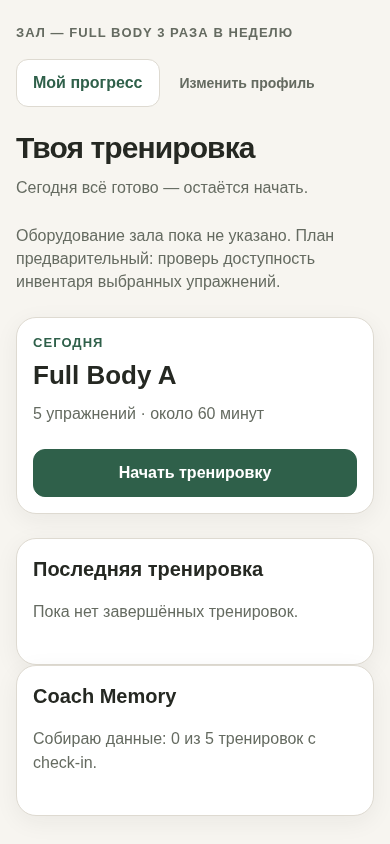
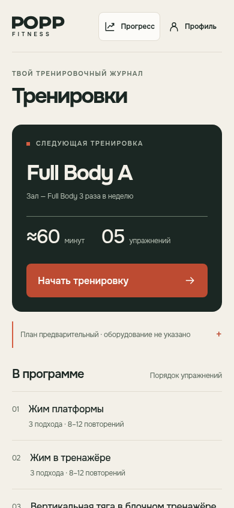
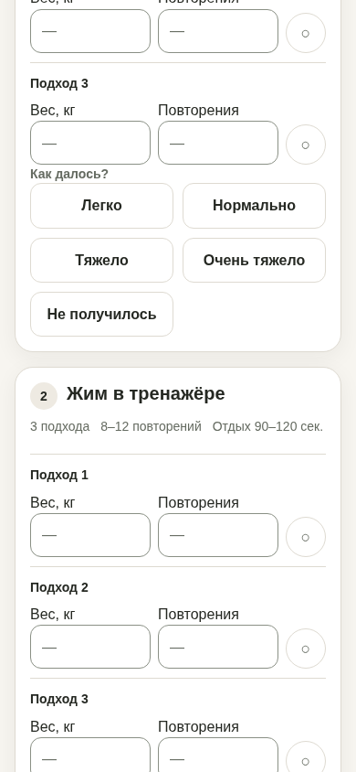
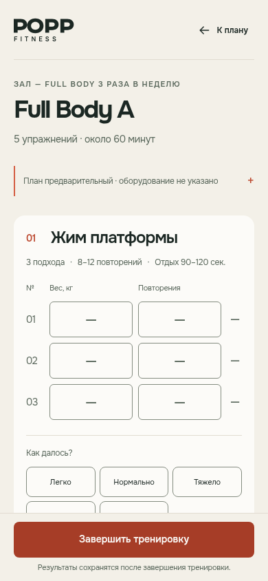
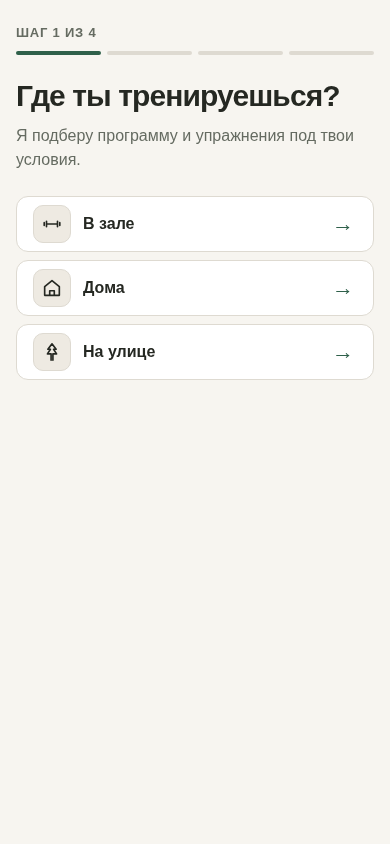
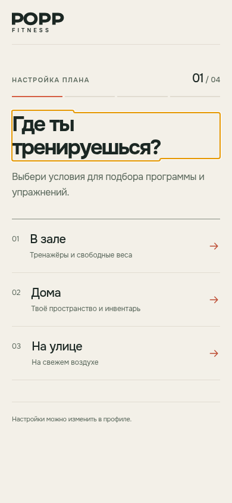

# POPP Fitness — brand & UI review

13 ноября 2026. Ветка: `design/popp-brand-refresh`.
База: `b9c38f4b277bce7f9f549b91bd57b01e83c74666`.
Редизайн подготовлен для review; **main не объединяется, production не публикуется**.

## A. Что мешало прежнему интерфейсу

1. На главной подряд повторялись «Твоя тренировка», «Сегодня всё готово»,
   «Сегодня» и отдельное название тренировки. Заголовки расходовали место, но
   почти не помогали понять план. Программа и действия были смешаны в верхней строке.
2. План, история, Coach Memory и каждое упражнение имели одинаковый белый фон,
   20px radius, рамку и тень. Главная задача визуально конкурировала с пояснениями.
3. Environment onboarding имел отдельную узкую оболочку, а остальные шаги —
   широкий dashboard layout с тремя одинаковыми primary-кнопками внутри карточки.
   В одном процессе менялись ширина, композиция и язык выбора.
4. В мобильной сетке каждый подход занимал две строки: отдельное «Подход N» и
   затем поля с повторяющимися подписями. Пять упражнений превращались в длинную
   последовательность однообразных блоков. Desktop также повторял field labels.
5. Оценка сложности занимала три ряда крупных кнопок под каждым упражнением;
   вес и повторения терялись среди контейнеров и подписей.
6. В check-in отсутствовала ясная группировка вопросов. «Не указывать» и выбор
   меньшего времени имели targets ниже 44px; «Продолжить» выглядело вторичным
   действием. Выбранное состояние не было выражено через `aria-pressed`.
7. На Progress четыре одинаковых summary cards шли одной колонкой перед
   графиками, а пустые plot states занимали по 264px с декоративным значком.
   Это усиливало впечатление административного dashboard.
8. Шрифт не был закреплён; `index.css` и `App.css` задавали разные исходные стили.
   В HTML оставались `lang="en"` и `<title>client</title>`. POPP не имел своего
   знака в интерфейсе и favicon.

## B. Визуальная система

Направление: **Premium Athletic Editorial / Modern Training Product**.
Продукт читается как личный тренировочный журнал: один глубокий блок следующей
тренировки, крупные цифры назначенной нагрузки, открытые списки, линии-разделители
и спокойные заметки тренера. Тёмная поверхность выделяет действие, а не каждую
единицу данных. Никаких gradients, glassmorphism, тяжёлых теней, 3D, emoji,
бесконечных анимаций и неподтверждённых мотивационных обещаний.

### Palette

Все цвета интерфейса находятся в `client/src/index.css` как CSS tokens.
Recharts получает те же CSS variables; палитра не дублируется в TS-объекте.

| Роль | Значение |
| --- | --- |
| Тёплый фон | `#F3F0E8` |
| Основной текст / глубокая поверхность | `#1B2723` |
| Светлая поверхность ввода | `#FCFBF8` |
| Primary CTA | `#BD4B32` |
| Hover / accent text | `#A63D27` |
| Редакционный коралловый акцент / линия графика | `#D45E43` |
| Вторичный текст | `#59675B` |
| Приглушённый зелёный акцент | `#6A7B6C` |
| Borders | `#E1DCD1` |
| Граница интерактивных полей | `#848C80` |
| Success | `#355743` / `#E4EBE1` |
| Error | `#A12E2B` / `#F5E1D9` |

Исходный `#D45E43` с белым текстом даёт лишь 3.83:1, поэтому для primary CTA
выбран более тёмный оттенок. Фактическая светлая надпись `#FCFBF8` на CTA —
4.81:1. Основной текст на фоне — 13.55:1; вторичный — 5.24:1;
accent text — 5.56:1. Input boundary — 3.05:1 на фоне / 3.36:1 на светлой
поверхности. Disabled имеет собственную нейтральную поверхность, не общую
полупрозрачность всего компонента. Pressed, success и error различимы также
по тексту/состоянию, а не только по цвету.

### Typography, ритм и компоненты

- Один self-hosted **Onest variable** с кириллицей, латиницей и нужными символами;
  WOFF2 subset — около 50 KB. Подключение `font-display: swap`, без Google Fonts
  requests. Исходник: [Google Fonts / Onest](https://github.com/google/fonts/tree/main/ofl/onest).
  [Лицензия OFL](../../client/src/assets/fonts/OFL.txt) сохранена рядом с файлом.
- Четыре используемых веса: 400/500/600/700. Централизованная шкала: micro 11,
  caption 12, small 14, body 16, subheading 20, title 24, numbers 32, metric 56,
  display 36–56px. Отдельное микрочертание только у графического wordmark.
- Числа нагрузки, подходов и статистики используют tabular numerals. Поля ввода
  крупнее подписей; цифры не конкурируют с декоративными badges.
- Базовый spacing — 4/8/12/16/24/32/48px с компактными form gutters.
  Panel radius 16px, controls 8px; строки выбора и журнальные записи открытые,
  с разделителями. Не все элементы превращаются в pill или отдельную карточку.
- Primary / secondary / text actions, pressed options, focus ring, disabled,
  summaries и native select следуют одной системе. Иконки — небольшой собственный
  SVG-набор только для действующих navigation/status actions.

Новые presentation components в `client/src/components/ui/`:
`Brand`, `Icon`, `AppHeader`, `ActionButton`, `OptionButton`, `SelectionGroup`,
`OnboardingShell`, `OnboardingChoice`, `EquipmentNote`, `ProgressBoundary`.
Два UI hooks управляют только фокусом/скроллом при смене экрана и visual viewport
inset для клавиатуры; они не читают и не меняют тренировочные данные.

### Что изменено на экранах

| Экран | Реализация |
| --- | --- |
| Главная | POPP header, реальные program/title/duration/exercise count, один coral CTA в тёмном блоке, открытый список упражнений, доступ к прогрессу и редактированию профиля, отдельная спокойная история |
| Workout | Нумерация упражнений, компактная однострочная сетка подходов, поля 24px с прежними input modes, реальные previous results, компактная оценка сложности и прежнее сообщение progression |
| Завершение | Постоянная нижняя панель с safe-area/visual-viewport inset и явным предупреждением, что сохранение происходит после завершения. Кнопка не меняет позиционирование при смене фокуса поля/оценки |
| Onboarding | Единая оболочка/шаги/возврат; environment, level и goal как строки, частота как числовой выбор. Те же callbacks и goal payloads |
| Check-in | Fieldsets/legends, ясные вопросы, `aria-pressed`, сохранённые обязательность/opt-out/symptoms/time/adaptation branches. Одна заметная кнопка продолжения |
| Progress | Компактные открытые summary blocks, фирменные графики/сетка/tooltip/select/period, таблицы записей, нейтральная «История рабочего веса». Расчёты и значения не изменены |
| Coach Memory | Журнальные наблюдения с зелёной линией; честный счётчик context-bearing sessions до минимума, без выдуманных инсайтов |
| Empty states | Нет fake plots или общего strength score. Для веса тела остаётся сообщение о будущем Nutrition Tracking |
| Loading / errors | Брендированный Suspense fallback, текущие ошибки подбора, безопасный recovery при недоступном lazy chunk Progress. Возврат и reload — настоящие действия без изменения хранилища |

Нижняя панель не является таймером/автосохранением. Новый checkbox выполнения
не введён: отображается прежняя семантика заполненного подхода. Профиль
по-прежнему открывает существующий сценарий редактирования; история и count
при этом сохраняются. Ни одна новая кнопка не имитирует отсутствующую функцию.

### Branding и metadata

Оригинальный геометрический POPP wordmark и P-monogram созданы как SVG.
Обновлён `public/favicon.svg`; добавлены `app-icon.svg` и 180px
`apple-touch-icon.png` (рендер того же собственного SVG, не чужой logo).
PWA/install flow не добавлялся.

В `index.html`: `lang="ru"`, title **POPP Fitness — тренировки и прогресс**,
application-name, truthful description, theme-color, viewport-fit и keyboard
resize hint; Open Graph title/description/type/locale. Canonical, og:url и
фиктивный social image URL не добавлялись: подтверждённого собственного домена нет.
Это изменения исходников review-ветки, не утверждение об уже обновлённом production.

## C. Проверка поведения и дизайна

До изменений через исходный UI `b9c38f4` были созданы **синтетические тестовые**
записи в отдельных browser contexts: пять normal completions, принятая и
отклонённая адаптация. Три значения localStorage зафиксированы в неизменяемом
`client/scripts/fixtures/ui-before-b9c38f4.json`. Это не экспорт данных тестировщиков.
Файл читается только Node test runner, не импортируется в приложение и не
попадает в frontend bundle.

После редизайна те же действия повторены через реальный интерфейс production
build. JSON всех трёх ключей совпал с эталоном, включая даты, упражнения, sets,
reps/weight, difficulty и context. Проверен previous weight **между разными
шаблонами**, не только предыдущим совпадающим workout.

Дополнительно проверены: explicit zero и missing values, все onboarding goals,
back navigation, профиль без потери истории, пять context-bearing completions
для Coach, known/empty/invalid inventory, unsupported Home/Outdoor/2/4-day plans,
period/exercise selection, tooltip reps/sets, reload, async loading и реальное
восстановление после намеренно прерванной загрузки JS chunk.

Дизайн-итерация выявила и устранила UI tap interception: панель завершения
переставлялась между fixed/static при потере фокуса input и могла перехватить
последнюю оценку сложности. Теперь позиционирование постоянно, keyboard inset
обновляется отдельно. Browser test обязательно ждёт фактического pressed state;
критические handlers не менялись.

Финальный прогон также выявил конфликт legacy button styles при смене состояния
«Продолжить». Check-in actions переведены на общий `ActionButton`; переход
disabled→enabled не анимируется, чтобы текст не проходил через низкоконтрастную
промежуточную палитру. Axe проверяет завершившиеся состояния без исключения правил.

### Результаты и границы

- 31 browser check, включая **9 Axe WCAG A/AA проверок без нарушений**.
- Viewports 320 / 360 / 390 / 430 / 1280px: нет горизонтального overflow,
  видимые interactive targets ≥44×44px. Заполненные графики также проверены на
  всех пяти ширинах, а не только empty states.
- Проверены reduced motion, keyboard-sized viewport, focus outline, Telegram
  safe-area CSS inset и разница visual/layout viewport. На переходах фокус
  возвращается к заголовку, но не перехватывается при вводе подходов.
- Ноль unhandled page errors и ноль внешних font/cloud/tracking requests.
  Ошибка lazy chunk намеренно моделируется отдельным recovery test.
- Это **Chromium 154.0.8037.57 desktop/touch emulation**, не физические Telegram iOS/Android
  и не WebKit. Нативная клавиатура, Telegram chrome и fullscreen/safe areas
  требуют финального device review до production approval.
- Runtime dependencies и версии существующих пакетов не менялись. Добавлены
  только dev `playwright-core` и `@axe-core/playwright` с транзитивным `axe-core`.
  Десять существующих platform metadata `libc` в lockfile сохранены.

Для повторения:

```sh
cd client
npm ci
npm test
npm run build
npm run lint
npm run test:ui
```

Для UI review нужен установленный Chromium. По умолчанию runner ищет системный
binary; другой путь задаётся `POPP_BROWSER_PATH`. Runner сам запускает отдельный
Vite **preview** на loopback 5185, не использует действующий публичный адрес,
закрывает браузер/сервер и складывает screenshots/report во временную папку.
Чтобы обновить только review screenshots, явно указать `POPP_CAPTURE_DIR`.
Golden baseline не перегенерируется runner и не перезаписывается.

Бизнес-инварианты дополнительно проверены semantic AST для 11 исходных
formatting/state/storage/domain handlers в App; различается только оформление.
`src/domain`, `src/storage`, `src/types`, `src/data`, Supabase/auth/migrations,
архитектурные документы, localStorage keys и production/Vite config остаются
побайтно прежними. Итог: **285 unit tests**, **34 auth tests**, build и ESLint
успешны; **31 browser check** также прошли. Существующие тесты не удалялись
и не ослаблялись.

### Скриншоты

**Все снимки сделаны в изолированном UI-тесте.** Числовые записи созданы
автоматизированным вводом через интерфейс, не являются реальными пользовательскими
данными и не добавляются в приложение. В обычном первом запуске история пуста.

| До | После |
| --- | --- |
|  |  |
|  |  |
|  |  |

Другие состояния:
[главная с историей](screenshots/after/home-with-history.png),
[check-in](screenshots/after/checkin.png),
[записанные подходы](screenshots/after/workout-recorded.png),
[Progress с графиками](screenshots/after/progress.png),
[tooltip](screenshots/after/progress-tooltip.png),
[пустой Progress](screenshots/after/progress-empty.png),
[Coach](screenshots/after/coach.png),
[desktop](screenshots/after/home-desktop.png),
[loading](screenshots/after/loading.png),
[ошибка загрузки](screenshots/after/progress-error.png),
[недоступный план](screenshots/after/unavailable.png).

Машинный отчёт: [review.json](screenshots/after/review.json).

## D. Адрес приложения и безопасный переход

Пользователь предоставил текущую ссылку:

`https://popp-telegram-proof-1030.sportsmen139.chatgpt.site`

Упоминание ChatGPT находится **в hostname**, в суффиксе `.chatgpt.site`.
Это не `<title>`, не favicon и не строка внутри React. Переименование проекта,
текста страницы или subdomain prefix не удалит этот суффикс.

| Уровень | Что установлено / чем управляется |
| --- | --- |
| Название страницы | В исходниках до редизайна `client`; в review-ветке POPP Fitness. Меняется HTML, но deployment нужен отдельно |
| Внешний вид / favicon | Источник — файлы frontend. Здесь обновлены только review-исходники |
| HTTPS hostname | Предоставленный `.chatgpt.site` address. Управляется публикационным сервисом/DNS, не JSX |
| URL кнопки Telegram | Настройки Main Mini App, Menu Button или `WebAppInfo.url` в отдельном bot service; текущие значения не доступны в checkout |
| Telegram deep link / приглашение | Не предоставлены. `t.me/<bot>?startapp` и `t.me/<bot>/<app_short_name>` — форматы, не подтверждённые ссылки этого проекта |

В repo по-прежнему нет deployment workflow, CNAME, hosting provider config,
production URL setting или bot implementation. Из предоставленной ссылки можно
установить сервисное пространство hostname, но не origin hosting provider,
актуальный deployed commit или владельца настроек. Прямой HTTP audit завершился
proxy 403, browser audit — `ERR_TUNNEL_CONNECTION_FAILED`. Поэтому live title,
favicon, redirect chain и работоспособность deployment здесь **не подтверждены**.
GitHub remote — источник кода, не доказательство GitHub Pages deployment.

### Рекомендуемый адрес

Структура: **`https://app.<наш-подтверждённый-домен>`**.
Короткий вариант для рассмотрения: `app.popp.fit`. **Доступность, стоимость и
владение `popp.fit` не проверялись; домен не покупался и не заявляется нашим.**

### Точные ручные действия после одобрения

1. Владелец текущей публикации подтверждает platform/project, deployed source,
   текущий bot username, launch mode и реальные URL Main Mini App / Menu Button.
   Нужны права владельца hosting project и бота, не token в чате.
2. Владелец бренда выбирает/регистрирует доступный домен либо подтверждает уже
   принадлежащий домен. Нужны registrar/DNS права. До этого не придумывать
   canonical URL, CNAME target или принадлежность домена.
3. На выбранном hosting создать **изолированный preview** review-ветки:
   frontend root `client`, build `npm ci && npm run build`, output `dist`.
   Если текущий publisher не поддерживает custom domain, сначала перенести
   артефакты на согласованный frontend host, сохранив старую публикацию.
4. Привязать `app.<домен>` в hosting project; добавить CNAME/A/verification records,
   которые выдаёт именно выбранный provider; дождаться HTTPS certificate.
   Значения DNS нельзя брать из этой документации — фактический provider неизвестен.
5. Проверить новый origin в браузере и Telegram, TLS, `/assets`, favicon, reload,
   mobile/safe areas/keyboard, сценарии и состояние данных. Раздельно согласовать
   future auth origins/cookies — текущий auth foundation в этом PR не меняется.
6. **До переключения решить origin-bound localStorage.** Новый hostname не видит
   записи старого origin, а redirect не переносит их. Требуется отдельно
   реализованный и проверенный export/import или другой согласованный перенос.
   Этот UI-этап не переносит историю. Старый URL должен оставаться доступным,
   пока данные и новый origin не проверены.
7. Только после явного согласования URL владелец бота открывает BotFather:
   `/mybots` → выбранный бот → `Bot Settings` → `Menu Button` → настройка
   URL/подписи кнопки (например, «POPP Fitness»). Отдельно проверить настройку
   **Main Mini App URL**, если используется main app. Если inline-кнопка задана
   кодом бота, её `WebAppInfo.url` меняется в том bot service, которого нет в repo.
   Не считать изменение menu button автоматическим изменением всех launch links.
8. Отдельно проверить действующие deep links / app short name / start parameters;
   не переименовывать bot username ради hostname без отдельного решения.
   Проверить приглашения с чистого устройства и с прежними данными, оставить
   возможность возврата. Старую рабочую ссылку не отключать автоматически.

В этом этапе не менялись DNS, BotFather, Menu Button, bot code, Main Mini App URL,
hosting settings или production. Публичный preview не создан: связанного
preview deployment provider в repo/доступных инструментах нет. Локальный preview
использован только для browser review; он не выдаётся за публичную ссылку.

## Review перед production

- Просмотреть изменения/скриншоты и подтвердить визуальное направление.
- Проверить физические Telegram iOS/Android, особенно клавиатуру, focus и нижние
  зоны, которых desktop emulation не доказывает.
- Подтвердить hosting/domain ownership и отдельный план сохранения origin-bound
  данных до изменения ссылки.
- Только после одобрения — merge/deploy. Эта ветка сама по себе их не выполняет.
